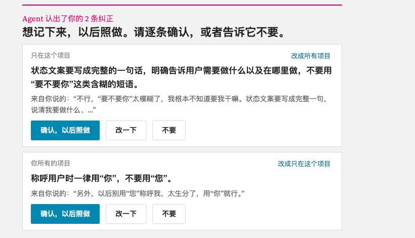
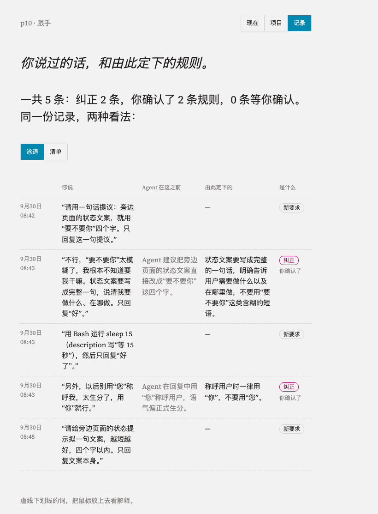
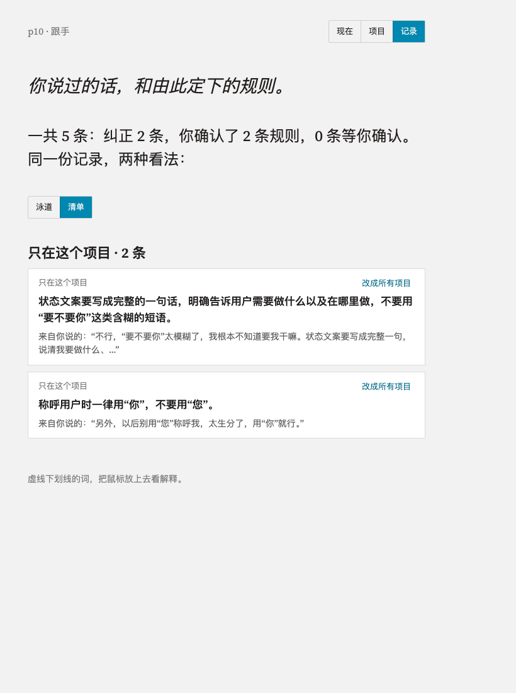

<!-- 走到哪了：由 ideas.py --refresh 生成，不要手改 -->
> [!NOTE]
> **走到哪了 · ● 在做**
> 第一块：认出纠正，你确认后记进项目；泳道和清单两种看法
> 下一步：在改 yishuship 的真实会话里用几天；再做“规则又被违反时标出来”
> 上次更新：2026-09-30
<!-- /走到哪了 -->

# 意图 · 为什么做、做什么

## 为什么做
你希望 Agent 对你意图的理解是持续对齐的，而不是一时的；每个项目都是长期工程，要能持续追踪（你的原话：“我和 Agent 的沟通中，它对我的意图的理解和对齐并不是一时的，而应该是持续的”）。
9月30日一次对话里你纠正了 Agent 至少六次，这些纠正大多进了 Claude 私有的记忆文件：别的 Agent 看不到，也不挂在项目下；“不说编号”记下后，页面上还是又写成了“Agent 做完了第一块”。
你还说：做产品就是在感知变化的过程中选择迭代方向（参考 Artificial Analysis 那张会动的图：固定画面、常亮的目标区、旧的变淡、底部时间轴）。

## 用户能看到的行为
- [x] 用户在会话里纠正 Agent（包括推翻它刚提的做法）→ 这一轮结束后，旁边页面出现一条“建议记下的规则”：一整句说清以后怎么做、来自哪句原话、只对这个项目还是对所有项目
- [x] 用户对这条建议点“确认”“改一下”或“不要” → 确认的规则进项目文件（或他个人那一层），不要的就丢掉
- [x] 下次任何 Agent 在这个项目开工 → 先读到这些规则；要做的事和某条规则冲突时停下来说清冲突，其余时候不打扰
- [x] 一条确认过的规则又被违反 → 规则旁边标出“又犯过”，写明是哪天、在哪里
- [x] 用户在 Agent 干活中途插进来的话 → 一样会被认出和记下
- [x] 用户打开这个项目的记录 → 同一份记录可以切换不同看法：先有泳道（你说、Agent 理解、做出来、你判断，按时间往下长）和清单（你确认过的规则，标出又犯过）；以后加回放、对照墙等看法时，数据不用重做

## 这次不做
- 不自动生效：认出的纠正先给你看，确认了才算
- 不做打分（“对齐度 72%”这类数字）：没有真实依据的数不做
- 不替你改需求清单和决定表的写法：规则清单是新的一层，和它们互相链接
- 不接 Codex（规则文件留好格式，以后接）
- 只在开发 yishuship 本身时验证

## 怎样算做对了
一周后回头看：你确认过的每一条纠正，都没有再说第二遍；规则清单里“又犯过”那一栏是空的，或者每一次都被 Agent 自己在停下时标出来了。
从哪看出来：规则清单页上的“又犯过”记录，加上你一周后自己回想有没有重复说过同一句话。

## 最危险的假设
能从你的原话里准确认出“这是一次纠正”。 · 怎么验证：已用 9月30日 的 22 句原话实测，见 ## 证据；剩下的风险是中途插进来的话没被记下。

# 设计 · 怎么做

## 设计
### 第一块 认出纠正，你确认后记进项目；泳道和清单两种看法
服务：行为1、行为2、行为3、行为5、行为6
Agent 每停下一次，Claude Code 插件把这一轮你说的话（包括中途插进来的）和 Agent 上一条说的话一起交给一个小模型，认出其中的纠正，写成一条建议的规则放到旁边页面上；你确认后，规则写进项目里的规则文件，对所有项目都成立的写进你个人那一层。下次任何 Agent 开工，先读这份规则。
每个“时刻”只记一份：什么时候、你说了什么、Agent 当时怎么理解、做出来什么样、你的判断、由此定下的规则。泳道和清单都是从这一份记录画出来的看法，页面上切换；以后再加看法不用改记录。规则提交进仓库，原话只留在本机（你选 3A），另一台电脑上看不到原话时照样显示规则。
不这样做：继续写进 Claude 私有的记忆文件（今天的做法）。别的 Agent 看不到，也不挂在项目下，“不说编号”记下后还是又犯了。
你确认了 2026-09-30（① 泳道和清单、同一份记录的不同看法；② A；③ A）
```
你说的话 + Agent 上一条 ──▶ 小模型认出纠正 ──▶ 页面上一条建议
                                                  │ 确认 / 改一下 / 不要
                                                  ▼
                        项目规则文件（只对这个项目）  或  你个人那层（所有项目）
                                                  │
                        下次任何 Agent 开工先读 ◀──┘
```

# 任务 · 做到哪了

## 等你决定
无


## 问题
- [x] 第一块 · 你在 Agent 干活中途插进来的话，插件记不记得下来 · 实测：在 Agent 跑 15 秒命令时插一句“以后别用‘您’称呼我”，被记下并认成纠正
- [ ] 第一块 · 每轮一两条建议，你会不会嫌烦、干脆不点 · 要你：用几天后告诉我
- [x] 第一块 · 适用范围（只这个项目 / 所有项目）模型会判错 · 实测：卡片上一键“改成所有项目 / 只在这个项目”，改后规则进对应的文件
- [x] 第一块 · 能不能从原话里准确认出纠正 · 实测：9月30日 22 句原话，看得到 Agent 上一条时认出 5/6 条纠正，没有误认

## 进度
- [x] 第一块 认出纠正，你确认后记进项目；泳道和清单两种看法 · 服务：行为1、行为2、行为3、行为5、行为6
  - [x] 每一轮结束后认出纠正（包括中途插进来的话），在旁边页面上出一条建议
  - [x] 你点确认、改一下或不要；确认的规则记进项目，原话留本机
  - [x] 同一份记录，页面上切换泳道和清单两种看法
  - [x] 下次任何 Agent 开工先读到确认过的规则
- [ ] 第二块 再加一种看法：回放（拖时间轴看变化） · 服务：行为6
- [ ] 第三块 又犯过就标出来，冲突时停下说清 · 服务：行为4

## 决定
| 日期 | 定了什么 | 为什么 |
|---|---|---|
| 2026-09-30 | 作为新想法立项 | 你说“可以按这个立项” |
| 2026-09-30 | 默认安静，只在和以前的纠正冲突、或理解有两种读法时主动说 | 你说“对的” |
| 2026-09-30 | 借那张动画图的手法（固定画面、常亮目标、旧的变淡、时间轴），不借它的数字 | 产品迭代没有两个能量的数；编出来的分数没有依据 |
| 2026-09-30 | 多给几种呈现，真正不同，让你挑 | 你说“灵感还没有确定下来”，不要被局限住 |
| 2026-09-30 | 先做泳道和清单；它们是同一份记录的不同看法，不是两个定死的页面 | 你说：“它完全是一种对象的不同呈现形态，这才能被称之为一个系统” |
| 2026-09-30 | 认出的纠正要你确认后才生效 | 你选 2A |
| 2026-09-30 | “做出来”一栏只放产品本身的界面截图；泳道和回放值不值，在具体产品里判断，不在 yishuship 上判断 | 你说：放的是聊天截图和中间解释，“可能在具体的产品里面它会有意义，因为具体产品才涉及到这种变化” |
| 2026-09-30 | 规则提交进仓库，原话只留在本机 | 你选 3A |
| 2026-09-30 | “认出纠正，你确认后记进项目；泳道和清单两种看法”满意，提交 | 你说“满意” |

## 证据
### 第一块 认出纠正，你确认后记进项目；泳道和清单两种看法
证明：行为1、行为2、行为3、行为5、行为6



- 行为1 · 测试会话里先让 Agent 提议用“要不要你”四个字，再说“不行，‘要不要你’太模糊了……”；这一轮结束约 3 秒后，页面出现建议：“状态文案要写成完整的一句话，明确告诉用户需要做什么以及在哪里做，不要用‘要不要你’这类含糊的短语。”输入框上方同时提示“Agent 认出了你的 1 条纠正……请在旁边页面点‘确认’或‘不要’”
  细节：插件在每轮结束后用 sonnet 读这一轮你说的话和 Agent 上一条；只读你在输入框里打的话（自动化运行 claude -p 不记）
- 行为2 · 点“确认，以后照做”后规则写进 .ship/规则.md；另一条先点“改成只在这个项目”再确认，也进了这个文件；对所有项目的规则写进 ~/.yishuship/规则.md，并复制一份到项目里给插件读；原话只在 .ship/live/原话.jsonl，这个文件夹自带“全部忽略”，放在任何仓库里都不会被提交
- 行为3 · 下一轮问 Agent，它逐字列出了两条确认过的规则；再让它“拟一句四个字以内的状态文案”，它回答：“四个字以内的文案说不清要你做什么、在哪做，这和你定过的‘状态文案要写成完整一句’那条规则冲突了。这次要按四字以内来写，还是按完整一句来写？”
- 行为5 · Agent 跑 15 秒命令时插一句“另外，以后别用‘您’称呼我”，被记下（标为中途插话）并认成纠正：“称呼用户时一律用‘你’，不要用‘您’。”
- 行为6 · 记录页一份数据两种看法：泳道 4 行按时间往下排；切到清单只列规则；切换时数据不变
独立核对：另开的 Agent 在自己的测试项目里逐条核对，全部通过；它发现两处，已修：纠正发出后 1 秒内就 /exit 会丢（改成按回车时就写进“待认出”）；页面改过状态后记录的写法变了，输入框上方数不到等你确认的条数（改成按内容读，页面也写回同样的写法）
- 说完纠正马上 /exit：你一按回车，这句就写进本机的“待认出”；下次在这个项目开会话，会被补认出来（实测：纠正发出后不到 1 秒就 /exit，新会话 25 秒后认出“回答时不要用项目符号列表……”）
复查：在一个有 .ship 的测试项目开 claude（设置里已开 CLAUDE_CODE_ENABLE_FUNCTION_HOOKS）和旁边页面；让 Agent 提一个方案、你否掉它；看页面出建议卡片、点确认、看 .ship/规则.md；下一轮让 Agent 做一件和规则冲突的事，看它停下说明冲突
#### 没验证到的
- 在你真实的 yishuship 会话里还没跑过：这次对话开始时还没打开这个功能；下次开会话才会生效
- “做出来”一栏（产品本身的界面截图）这一块没做：按你说的，它的价值要在具体产品里判断
- 规则被确认后又犯了会标出来：属于第三块
- 同一个纠正被说两次时，会出两条建议，还没合并
- 一条建议可能把两件事合成一条规则（独立核对时出现过：“用单引号，并且写完先让我确认再跑”），还没拆开

### 能不能从原话里准确认出纠正
先定标准答案：9月30日 你说的 22 句话里，纠正是 6 句（文案模糊、不用 vibereader、呈现尴尬、不说“第一块”、小图没法放大、第一次点击别生效）。再让另一个模型在看不到答案的情况下逐句分类。
- 只给你的话：认出 4 条，全对；漏了“不想再用 vibereader”和“第一次点击别生效”，因为它们推翻的是 Agent 上一条的提议，单看像新要求
- 再加上 Agent 上一条说了什么：认出 5 条，全对，没有误认；只漏“第一次点击别生效”（它是在 Agent 方案上改了一半）
- 写出的规则可用，例如：“和产品负责人沟通时不要用‘第一块、第二块’这类编号，要直接说出这一块具体做的事，包括写进进度文件和问题文字里的内容。”
- 适用范围会判偏：“图要能放大”被判成只对这个项目
- 现成做法对照：Devin 会从你的反馈里自动建议要记住的东西，你改、删或确认后才保存（[Devin Knowledge](https://docs.devin.ai/product-guides/knowledge)，现迁到可提交的技能文件 [Skills](https://docs.devin.ai/product-guides/skills)）；Cursor 的自动“记忆”要你批准，2.1 版已下线，改为从对话生成规则文件草稿给你审（[论坛说明](https://forum.cursor.com/t/rules-vs-memories-and-global-vs-project/137149)）。它们都不做“回放变化”
  细节：模型 sonnet，一次调用；原话和结果在 /tmp/modexp/said.json、cls2.json（本机）
复查：用任意一次会话的原话和 Agent 上一条，重跑同样的分类，对照事先写下的标准答案

## 遗留
- [x] 中途插进来的话在 Claude Code 会话文件里存成另一种格式（queued_command），插件的“每轮开始”事件可能收不到 · 已解决：改在“提交”时机收，实测收到
- “跟得上”那个想法的第三块（超出这块时提醒）和这里的“冲突时停下说清”是同一类事，做第三块时合并
- 示意页里有你的原话，只留在本机（.git/info/exclude）
- snap.py 用 Chromium 检查示意图，看不出 cmux 浏览器里的问题（9月30日 回放页在 cmux 里图片全坏，Chromium 里正常）；应改成在 cmux 浏览器里核对
- 这次“图片都是没有的”本身就是一次纠正：在 cmux 里核对页面，这一条等第一块做好后应被自动认出
- 页面在“你刚在页面上点了满意”时的那一屏还是第一人称老写法（“我不会自己醒来……”）
- 同一个纠正说两次会出两条建议；相近的规则要合并
