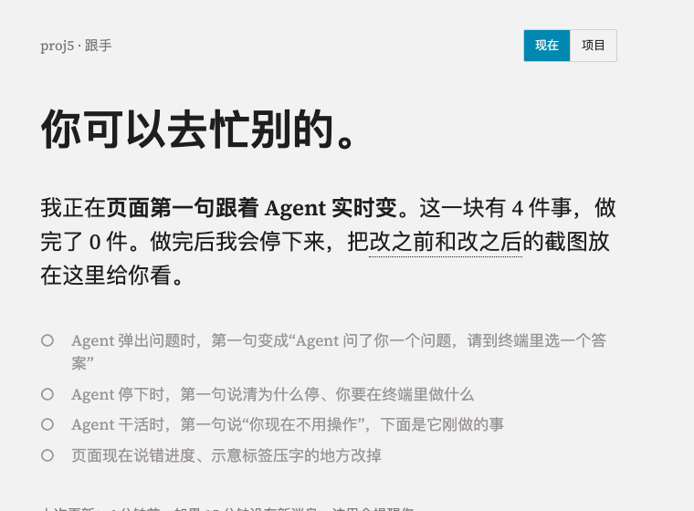
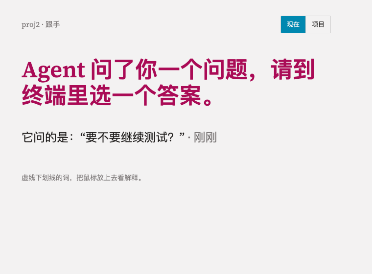
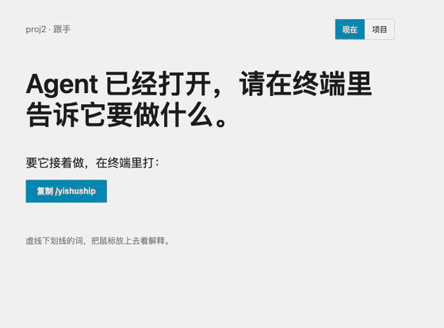
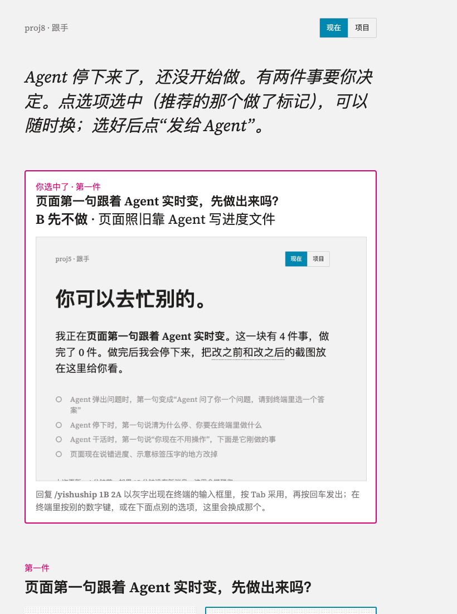
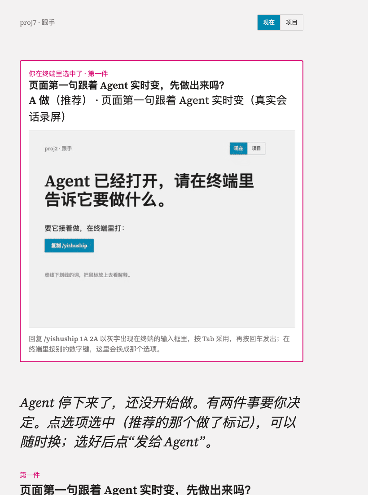

<!-- 走到哪了：由 ideas.py --refresh 生成，不要手改 -->
> [!NOTE]
> **走到哪了 · ● 在做**
> 第一块：页面第一句跟手
> 下一步：在改 yishuship 时日常用几天；再谈长期持续追踪怎么做
> 上次更新：2026-09-30
<!-- /走到哪了 -->

# 意图 · 为什么做、做什么

## 为什么做
你不写代码，靠 Agent 做东西。你最大的期待是“非常非常跟手”：Agent 一有动作，旁边马上看得见，还会告诉你下一步做什么（你的原话：“及时的可见性和交互性，是我对这个工具最大的期待，并且它具有引导性”）。
现在旁边那一页的每个字，都要靠 Agent 记得写进进度文件，而它常常忘：R-006 文件写着第十块，实际已经做到第十三块；R-021 一个下午的决定一条都没记下；“跟得上”那个想法里，两次真实会话都没出现“在验证”。
Claude Code 已经能把 Agent 的每一步直接告诉插件（2026-09-30 实测：文件一改，状态行立刻变，每次约 8 毫秒），不需要 Agent 记得去写。

## 用户能看到的行为
- [x] 用户在 Agent 弹出问题后看旁边的页面 → 1 秒内第一句变成“Agent 问了你一个问题，请到终端里选一个答案”，下面是问题原文
- [x] 用户在 Agent 停下后看页面 → 1 秒内第一句变成“Agent 已经停下，请在终端里告诉它下一步做什么”，并写明是正常做完、出错，还是你打断的
- [x] 用户在 Agent 干活时看页面 → 第一句是“Agent 正在工作，你现在不用操作”，下面一行是它刚做的事（跑检查、改了哪个文件），每一步 1 秒内更新
- [x] 用户在会话之后打开页面 → 看到“这次会话里发生了什么”：每条原话、Agent 做了什么、停在哪；这些都没有人手写
- [ ] 用户点开其中一条 → 看到 Agent 补写的“为什么这样做”，以及它连到哪条需求、哪个决定 → 第二块再定写法
- [x] 用户在 Agent 停下、有事要他决定时看输入框上方 → 每个选项一个方框，框里有小图；按数字键选中，回复以灰字出现在输入框里，按 Tab 采用
- [x] 用户选中一个选项（终端里按数字键，或在旁边页面上点）→ 旁边的页面放大这个选项：图片、动图、HTML 示意；两边的选择保持一致
- [x] 用户选好后在页面上点“发给 Agent” → 回复打进 Claude 的终端，Agent 开始干活；第一次点选项只是选中，Agent 正在干活时不发
- [x] 用户没在看这个终端时 → cmux 左侧栏写明要他做什么（“等你决定 2 项”），终端闪一下；Agent 开始干活就消失

## 这次不做
- 不拦截 Agent，也不替你做决定：只观察、只显示
- 不做独立的桌面应用；还是终端旁边这一页
- 不把原始记录整段倒给你看：页面只显示结论，原文放在点开之后的那一层
- 不把 Codex 接进来（记录格式留好位置，以后再接）
- 不在 vibereader 或别的产品上验证，只在开发 yishuship 本身时验证

## 怎样算做对了
在一次真实改 yishuship 的会话里，Agent 每次停下来问你，你在 1 秒内从旁边的页面知道要去终端做什么，而不是回头翻对话。会话结束后，你随便挑一件事，能在页面上看到当时的原话、Agent 做了什么、做到没有，而这一条没有任何人手写过。
从哪看出来：你下一次改 yishuship 的会话，结束时现场挑一件事试；另外，页面上每次状态变化的时间会和 Claude Code 事件的时间一起记下，能直接算出延迟。

## 最危险的假设
Claude Code 的这套接口（早期功能，需要 `CLAUDE_CODE_ENABLE_FUNCTION_HOOKS=1`）足够判断“Agent 在等你”这件事：弹出问题、等你批准一个操作、这一轮停下，都能在发生的那一刻收到。 · 怎么验证：做第一块时先在临时副本里把这三种时刻各触发一次，记下收到的时间；有一种收不到，就停下来给你看。

# 设计 · 怎么做

## 设计
### 第一块 页面第一句跟手
服务：行为1、行为2、行为3、行为6、行为7、行为8、行为9
yishuship 插件里加一个在 Claude Code 内部运行的小文件。Agent 每开始一轮、每调用一次工具、每停下一次，它都写两样东西：此刻的状态（给页面第一句用），和一行原始经过（留底，不提交到 git）。旁边的页面改成每 0.3 秒问一次“变了没”，变了才重画。没开这个功能、或会话已经关了，页面照旧读进度文件。
不这样做：只读 Claude Code 自己的会话文件（SpecStory 的做法）。Agent 一句话没说完文件里就还没有，做不到 1 秒内。
“等你批准一个操作”这一种状态这一块不做：插件读不到权限模式，分不清是弹框问你，还是自动模式下由分类器替你判断，只能写“可能在等你”。
你确认了 2026-09-30（选 1A；做完后你说“基本上算是满意”）
```
Claude Code 里 Agent 的每一步
  开始一轮 · 调用工具 · 这一轮结束 · 会话关闭
        │  hooks/register.ts（新）只看，不拦
        ▼
  .ship/live/now.json   此刻的状态和刚做的事（新，不提交）
  .ship/live/日期.jsonl  原始经过，一步一行（新，不提交）
        │  page.py 每 0.3 秒问一次“变了没”（原来 2 秒）
        ▼
  旁边页面的第一句
  （没有 now.json 或会话已关 → 照旧读进度文件）
```
可能出错的方式（先写下来，逐条验证）：
1. 没开 `CLAUDE_CODE_ENABLE_FUNCTION_HOOKS=1`，插件没加载 → 页面必须照旧工作，不能显示错的实时状态
2. Claude Code 被强制关掉，now.json 一直停在“正在工作” → 超过 15 分钟没有新动作要说出来
3. 子 Agent 结束一轮被当成主 Agent 停下 → 只认主 Agent 的一轮
4. 你回答了问题，页面还停在“问了你一个问题” → 回答后 1 秒内回到“正在工作”
5. 问题弹出时你按了 Esc 打断 → 显示“你打断了 Agent”
6. 会话关了（/exit）→ 显示会话已经关了，以及怎么接着做
7. Agent 停下时进度文件里有要你决定的问题 → 显示那几个问题，第一句写清要你在终端回复什么
8. 昨天的 now.json 被当成现在 → 会话关闭后不再当实时用
9. 原始经过被提交到公开仓库 → 写第一行之前 .gitignore 已经挡住
10. 页面每 0.3 秒重画整页，费电脑 → 只在变了的时候重画
11. 插件出错拖住 Agent → 每一处都兜住错误，照常放行
12. 没有 .ship 的项目里也写文件 → 只在有 .ship/ideas 的项目里写
13. 页面现在说错进度（“我做到第一块”其实还没做）、示意标签压住文字 → 改掉

# 任务 · 做到哪了

## 等你决定
无

## 问题
- [x] 第一块 · Claude Code 能不能在“弹出问题、这一轮停下”时立刻告诉插件 · 实测：真实会话里页面 0.04–0.27 秒跟上；“等你批准”收不到能区分的信号，这一块不做
- [x] 第一块 · `CLAUDE_CODE_ENABLE_FUNCTION_HOOKS=1` 能不能写进 Claude Code 的设置文件就生效 · 实测：用 --settings 带上 env，插件加载并写出 now.json
- [ ] 第二块 · Agent 停下时补写“为什么”，会不会又变成靠它记得去写 · Agent：第二块设计时回答
- [x] 第一块 · 不靠人手写，能不能从真实记录里抽出“原话、做了什么、停在哪” · 实测：本次会话 8 轮全部抽出（示意页）；“查了 10 次资料”说不出查到了什么，要第二块补

## 你的反馈
- [x] 2026-09-30 · 你的回答：满意 · 已处理：提交 7f193ce，并打开了 CLAUDE_CODE_ENABLE_FUNCTION_HOOKS

## 进度
- [x] 第一块 页面第一句跟手 · 服务：行为1、行为2、行为3、行为6、行为7、行为8、行为9
  - [x] Agent 弹出问题时，第一句变成“Agent 问了你一个问题，请到终端里选一个答案”
  - [x] Agent 停下时，第一句说清为什么停、你要在终端里做什么
  - [x] Agent 干活时，第一句说“你现在不用操作”，下面是它刚做的事
  - [x] 页面现在说错进度、示意标签压字的地方改掉
  - [x] 输入框上方：选项方框加小图，按数字键选中
  - [x] 选中后旁边页面放大；页面上点也能选，两边一致
  - [x] 页面上点“发给 Agent”才发出，Agent 忙时不发
  - [x] cmux 侧栏写明要你做什么，只在需要你时出现
- [ ] 第二块 这次会话的经过，点开能看到为什么 · 服务：行为4、行为5

## 决定
| 日期 | 定了什么 | 为什么 |
|---|---|---|
| 2026-09-30 | Claude Code 的插件接口能在进程内画状态行，比脚本快、更及时 | 实测：/tmp/modexp，文件一改立刻变，脚本要等这一轮结束；每次约 8 毫秒，脚本约 78 毫秒 |
| 2026-09-30 | 状态文案一律写完整一句：Agent 怎样、你要做什么、在哪做 | 你说：“要不要你”这种四个字很模糊，工具本身不能造成歧义 |
| 2026-09-30 | 只在开发 yishuship 本身时验证 | 你说：怕又一直在开发 vibereader，完全没在开发这个工具 |
| 2026-09-30 | 实时的那一层用 Claude Code 插件接口；读会话文件留作退路 | 你说最大的期待是跟手；会话文件要等一句话说完才有，也没法在 Claude Code 里弹出东西 |
| 2026-09-30 | 先做第一块：页面第一句跟手 | 你选 1A |
| 2026-09-30 | 原始记录只留在你电脑上，不跟 git 提交 | 你选 2A：仓库是公开的，原话和本机路径不能出现在 GitHub 上 |
| 2026-09-30 | 页面现在的呈现要改：第一句说错了进度，示意页套在页面里分不清真假，标签压住文字 | 你说“这个呈现还是稍微有点尴尬”，附截图；并进第一块一起改 |
| 2026-09-30 | “此刻要你做什么”也放到 Claude Code 输入框正上方 | 你认可：眼睛本来就在输入框附近，比转头看页面跟手 |
| 2026-09-30 | 选项用方框加小图；看不清就在旁边页面放大，选中即放大 | 你说小图没法放大，A 和 C 要结合，大图放在 cmux 旁边；侧栏（B）在普通模式下挤在输入框上方，暂不用 |
| 2026-09-30 | 按键选中后回复做成输入框里的灰字建议，按 Tab 采用 | 实测：直接填进输入框后，输入框不空，再按数字会被当成文字，没法换选择 |
| 2026-09-30 | 页面上点选项只是选中，点“发给 Agent”才发出 | 你说：最好不是第一次点击就生效，留犹豫的空间 |
| 2026-09-30 | cmux 侧栏只写“要你做什么”，不再发通知、不写“在工作” | cmux 自己已经在每轮结束时通知、在侧栏显示 Claude 在跑；再发会重复 |
| 2026-09-30 | 输入框上方和页面上点选这两部分并入这一块一起做完再给你看 | 你说 ok |
| 2026-09-30 | 这一块满意，提交；打开 CLAUDE_CODE_ENABLE_FUNCTION_HOOKS | 你说“基本上算是满意”，并提出要把它做成每个项目长期持续追踪的系统 |
| 2026-09-30 | 带你原话的示意图和截图只留在本机，不提交 | 你选过 2A；这些图里有这次对话的原话和本机路径 |
| 2026-09-30 | 原始经过由 Claude Code 记，“为什么”由 Agent 补 | SpecStory、Entire 已证明原始会话能自动存下；它们都不连到想法、需求，也不告诉你下一步做什么，这是 yishuship 自己的事 |
| 2026-09-30 | 满意 | 在页面上点了满意 |

## 证据
### 第一块 页面第一句跟手
证明：行为1、行为2、行为3、行为6、行为7、行为8、行为9





- 行为1 · Agent 用选择题问你“要不要继续测试？”，页面第一句 0.1 秒后变成“Agent 问了你一个问题，请到终端里选一个答案”，下面是“它问的是：‘要不要继续测试？’”；你选了“继续”，0.04 秒后变回“Agent 正在工作，你现在不用操作”
  细节：真实 tmux 会话 + 无头 Chromium 每 0.05 秒读一次第一句；延迟 = 页面变化时间 − 插件记录里的事件时间
- 行为2 · 这一轮正常结束，0.19 秒后第一句是“Agent 已经停下，请在终端里告诉它下一步做什么”，下面是它最后说的“收到”；在它跑命令时按 Esc，0.21 秒后是“你打断了 Agent。请在终端里告诉它接下来做什么”；/exit 后是“Agent 的会话已经关了。要接着做，请在终端里打 /yishuship”
  细节：/exit 后第一次测试时页面退回读进度文件，显示成“Agent 正在工作”（进度文件里留着旧的 now），已修：会话关闭晚于进度文件最后一次修改时，不再相信那个 now
- 行为3 · 干活时第一句是“Agent 正在工作，你现在不用操作”，下一行跟着每一步变：“它刚开始这一轮” → “它正在运行命令：等 4 秒”（0.27 秒后）
- 页面其它两处：还没做完任何一块时，不再说“我做到第一块”；“下面两事”改成“有两件事要你决定。请在下面选好，复制回复，贴到终端里”；示意图的标签移到图片下方，不再压字
- 原始经过没有人手写：这次测试会话留下 10 行，包括你的原话、问你的问题和你的回答、每次停下的原因（正常答完 / 被打断）、会话关闭；存在 .ship/live/，git 已忽略
独立核对：另开的 Agent 用自己的测试项目和真实会话，逐条核对 5 条声明，全部通过；新增的四条（输入框上方选项、选中放大、页面上确认发出、cmux 侧栏）另一个 Agent 在自己开的 cmux 分屏里核对，全部通过；它量到的延迟 30–56 毫秒。它指出两点：打断时如果还有等你决定的问题，页面先显示问题（有意这样排）；会话关了而项目里没有进行中的想法时，写的是“没有进行中的想法”（记进遗留）




- 行为6 · Agent 停下、有两件事要你决定时，输入框上方出现四个方框，每个有小图和“1: ● A 做（推荐）”这样的字；按 2 选中“先不做”，输入框里出现灰字“/yishuship 1B 2A”，再按别的数字还能换
  细节：直接填进输入框时，输入框不空，后按的数字被当成文字（实测出现 “/yishuship 1B 2A31”），所以改成灰字建议；分屏窄时方框改成上下排
- 行为7 · 按 2 后旁边页面放大“B 先不做”的截图；在页面上点第二题的 B，终端里立刻变成“4: ● B”；动图、HTML 示意都能放大
- 行为8 · 页面上点选项只是选中；点“发给 Agent：/yishuship 1B 2B”后，终端收到这句并开始干活（插件记下的原话是 “1B 2B”）；Agent 干活时再点，页面提示“Agent 正在工作，等它停下再发。你的选择已经记下了。”
- 行为9 · Agent 停着等你决定时，cmux 左侧栏出现“等你决定 2 项”（品红），Agent 一干活就消失，打断后又出现；出现时让终端闪一下
  细节：cmux 自己已经在每轮结束时发通知、侧栏显示 claude_code=Running，这里不再重复
- 之前的行为还在：正式版重跑，跑命令 0.06 秒、弹问题 0.33 秒、回答后 0.31 秒、停下 0.30 秒、打断 0.29 秒；/exit 后显示“会话已经关了”
复查：在 cmux 里开一个带 `CLAUDE_CODE_ENABLE_FUNCTION_HOOKS=1` 的 Claude Code 会话和旁边的页面，让 Agent 先跑一个命令，再用选择题问你一个问题，回答后让它停下，再开一轮按 Esc，最后 /exit；页面第一句依次是“正在工作 → 问了你一个问题 → 正在工作 → 已经停下 → 你打断了 → 会话已经关了”，每一步 1 秒内变；再让它停在一个有两个问题的想法上，按数字键选、看页面放大、在页面上点另一个选项看终端跟着变、点“发给 Agent”，`cmux list-status` 看侧栏
#### 没验证到的
- 终端闪一下：命令执行成功，但你当时没在看，没人亲眼确认过
- 动图、视频做不了终端里的小图（终端只认 PNG），方框里显示文字；页面上放大正常
- 视频：mp4 在页面上放大后自动播放（实测：Chromium 里 2.5 秒播到第 2.6 秒）；cmux 自带的浏览器没单独试
- “改之前”的截图是改完后用 git 里的旧版页面在同一场景下补拍的，不是动手前在运行中的页面上拍的；你发来的那张截图（before-你的截图-等你决定.png）是动手前的真实样子
- 你自己的 Claude Code 还没开这个功能：要在 ~/.claude/settings.json 里加一行才会生效（已测：写进设置就能生效，不用每次手动开）
- 等你批准一个操作：这一块没做，插件分不清是弹框问你，还是自动模式替你判断
- 同一个项目同时开两个会话时，页面显示最后动的那一个，没测
- 终端底部那一行没改，还是靠进度文件

### 不靠人手写，能不能从真实记录里抽出“原话、做了什么、停在哪”
本次会话 8 轮，每轮的原话、改了哪些文件、跑了几次检查、停下来问的那句话都抽出来了（示意页 ../evidence/2026-09-30-live-record/mock-1.html）。“查了 10 次资料”这类只说得出做了几次，说不出查到了什么。
细节：来源 `~/.claude/projects/-Users-mahaoxuan/d91ea87c-….jsonl`；现成做法：SpecStory 把同一份文件转成项目里的 Markdown，Entire 在每次提交时把会话存进 git 的隐藏分支。

## 遗留
- 实验副本在 /tmp/modexp，重启后会被清掉；第一块开始时把需要的部分搬进仓库
- 等你批准一个操作：插件读不到权限模式，分不清弹框问你还是自动模式替你判断；等 Claude Code 给出权限模式再做
- 页面其它地方（“我推荐”“我没验证到的”）还是第一人称，和第一句的“Agent …”不统一
- 进度文件里留下的 now 在没开这个功能时仍会过期（R-006 那类问题），只有开了功能才被纠正
- 会话关了、项目里又没有进行中的想法时，页面写“这个项目现在没有进行中的想法”，没说会话已关
- 带你原话的 13 个证据文件只在本机（.git/info/exclude），换电脑看不到；需要时用不含原话的内容重做
- “跟得上”那个想法的第三块（超出这块时提醒）要不要并进来，第二块时再看
